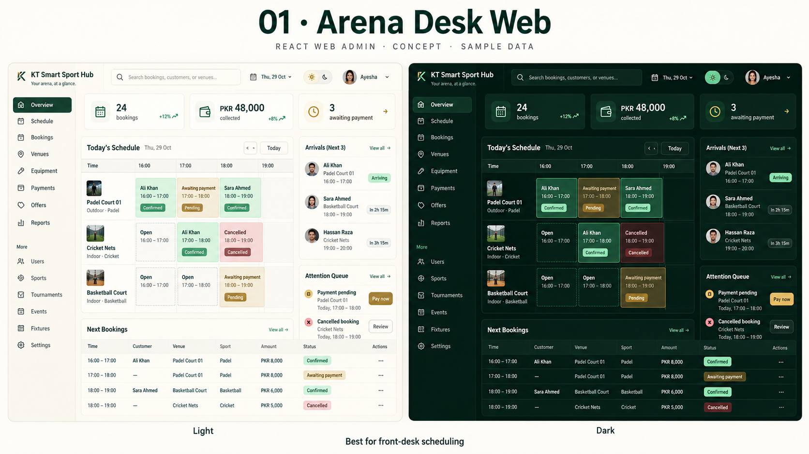
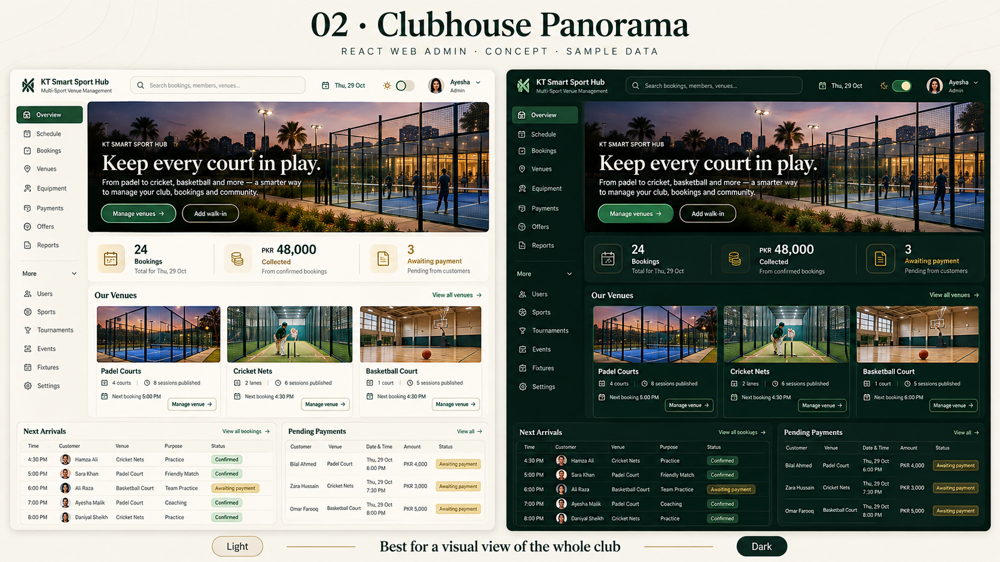
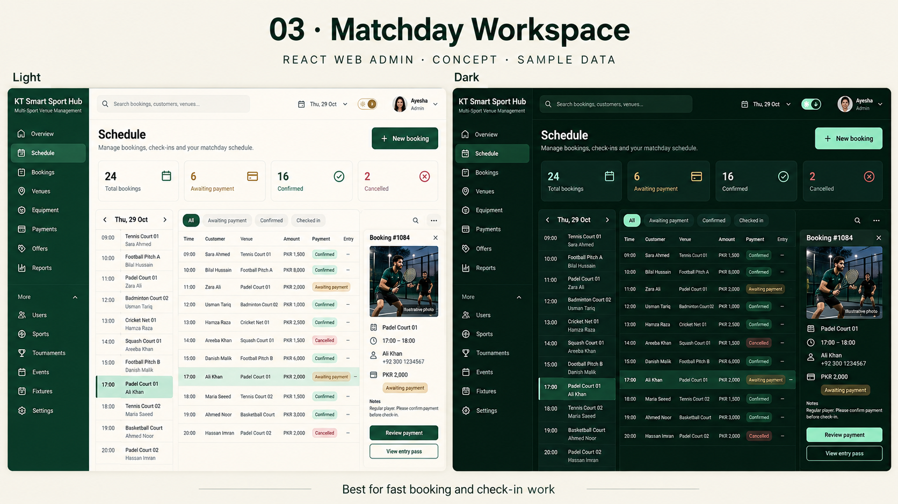
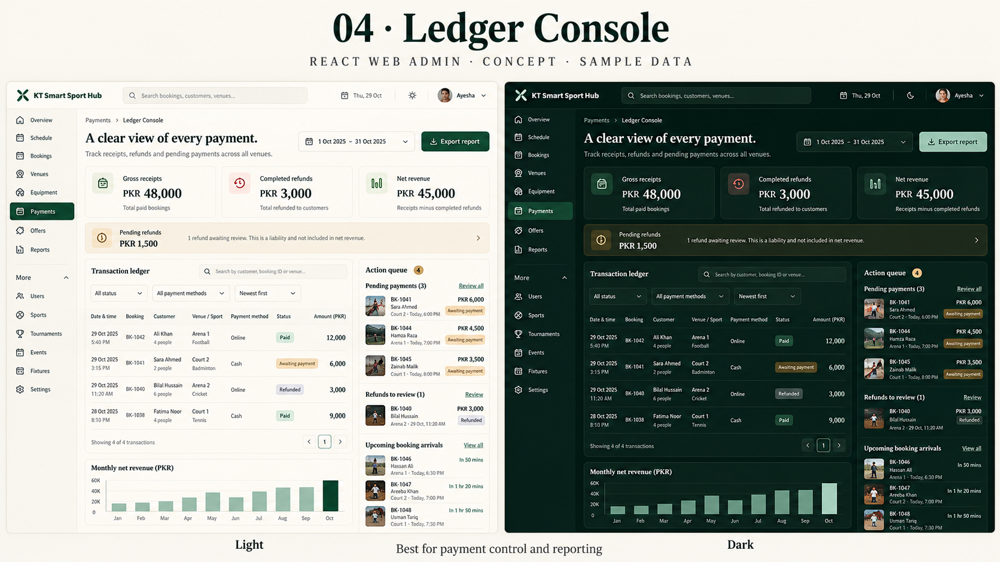
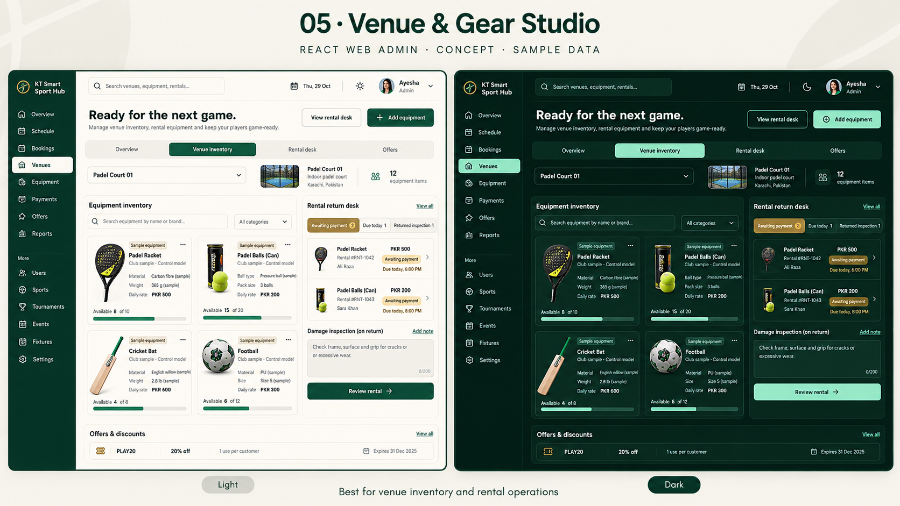

# React web admin concepts

Created 29 October 2026 with the built-in image-generation tool. Five separate concept renders, each showing light and dark treatments. These images are proposed designs with sample data, not implementation captures. **Selected direction: 01 · Arena Desk Web**, with a white light-mode sidebar and the other concepts adapted into supporting pages. See [implementation and verification](../../qa/REACT_ADMIN_UI.md) for the completed React interface and actual browser captures.

The reference direction is the existing Flutter Arena Desk admin: warm cream, forest green, muted brass and deep pine dark surfaces. User confirmed the target is the React **web** admin, rather than a new React Native app.

## Recommendation

Start with **01 · Arena Desk Web** for the closest match to the selected mobile admin. Use **03 · Matchday Workspace** if rapid booking and check-in work is the higher priority. The selected shell can borrow the equipment workspace from option 05 and the financial hierarchy from option 04.

## Renders

### 01 · Arena Desk Web

Closest match to Flutter Arena Desk; a daily timetable, arrivals and payment-attention queue.

### 02 · Clubhouse Panorama

A photo-led overview of venues with a calmer editorial hierarchy.

### 03 · Matchday Workspace

A booking list, day agenda and contextual detail pane for faster desk work.

### 04 · Ledger Console

A payment ledger with gross, refunds, net revenue and a separate pending-refund queue.

### 05 · Venue & Gear Studio

A catalogue and rental desk focused on equipment, specifications, returns and offers.

## Scope and review notes

All names, dates, equipment, financial figures, availability and imagery are illustrative sample content. AI-rendered labels and numerical details should be corrected against server data during implementation. Some proposed workspace arrangements, filters and charts require interface work; their presence in these boards does not establish current functionality. Revenue, payment, rental and entry-pass protections must remain in the API. Equipment photos and sample specifications do not establish any real venue's stock.

The concept renders themselves do not establish implemented behavior. The selected React implementation and its responsive/theme/interaction verification are recorded separately in the implementation notes above. No production deployment or database migration was performed for the UI change.

## Saved prompts and provenance

See [prompts.json](prompts.json) for the exact final prompt for every board. Tool: built-in `image_gen.imagegen`; no external CLI/API runner used. Original generated files remain in the tool's default generated-images directory; the five review copies are preserved alongside this document.

## Project snapshots published before rendering

- KT_SportM main: `d566c081a42458f4038964078e96e2450e267ef9`.
- Kt_firebase main: `90846b0884bf8d7e42e7527679e0f7a859e0b3bc`.

Both pre-design snapshots contain identical project files, preserving each repository's history. These later concept assets are archived with the project alongside the selected implementation and review captures.
